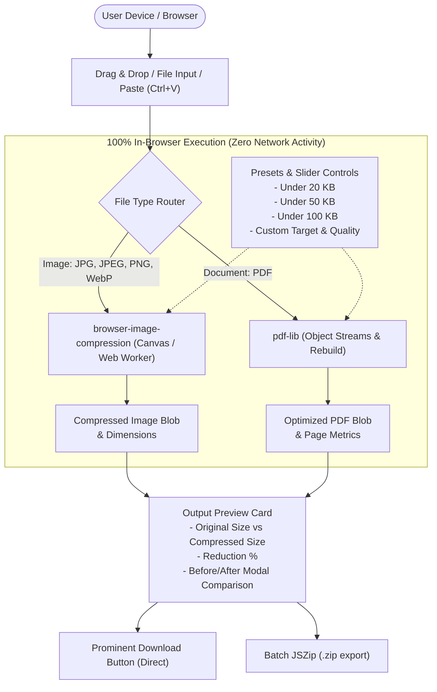

# ShrinkPure — Pure Client-Side Image & PDF Compressor

A production-ready, single-page responsive web application built with **Next.js (App Router)** and **Tailwind CSS** for **100% pure client-side image and PDF compression**. 

> **100% Private & Secure — Files are processed on your device and never uploaded to any server.**

---

## Architecture & Data Flow



---

## Key Features & Requirements Matrix

| Requirement | Implementation Detail | Source File |
| :--- | :--- | :--- |
| **1. Pure Client-Side Processing** | `browser-image-compression` for images, `pdf-lib` for PDFs. Zero external API calls, zero server telemetry. Runs on browser Canvas, WebAssembly, and Web Workers. | [`src/lib/compressors/imageCompressor.ts`](src/lib/compressors/imageCompressor.ts)<br>[`src/lib/compressors/pdfCompressor.ts`](src/lib/compressors/pdfCompressor.ts) |
| **2. Drag-and-Drop Area** | Modern drag-and-drop zone with active hover states, drag pulsing, file picker fallback, format filters (`.jpg`, `.jpeg`, `.png`, `.pdf`), and clipboard paste (`Ctrl+V`). | [`src/components/DropZone.tsx`](src/components/DropZone.tsx) |
| **3. Quick Target Presets** | One-touch preset buttons for **"Under 20 KB"**, **"Under 50 KB"**, **"Under 100 KB"**, plus custom target size slider (10 KB – 1000 KB) and manual quality adjustment slider (10% – 100%). | [`src/components/CompressionControls.tsx`](src/components/CompressionControls.tsx) |
| **4. Output Preview & Download** | Live display of original file size, compressed file size, percentage reduction badge (e.g. `-74%`), visual Before vs After modal comparison, PDF preview in new tab, prominent gradient Download button, and multi-file ZIP export. | [`src/components/FileCard.tsx`](src/components/FileCard.tsx)<br>[`src/components/BatchSummary.tsx`](src/components/BatchSummary.tsx) |
| **5. Trust & Privacy Banner** | Clean prominent badge: *"100% Private & Secure — Files are processed on your device and never uploaded to any server."* with security indicators. | [`src/components/TrustBanner.tsx`](src/components/TrustBanner.tsx) |
| **6. Reserved Ad Placements** | Clean, responsive placeholder containers (`<div>`) labeled `ad-slot-header`, `ad-slot-action`, and `ad-slot-footer`. | [`src/components/AdSlot.tsx`](src/components/AdSlot.tsx) |

---

## Project Structure

```
├── src/
│   ├── app/
│   │   ├── favicon.ico
│   │   ├── globals.css              # Tailwind CSS v4 setup
│   │   ├── layout.tsx               # Root layout & SEO metadata
│   │   └── page.tsx                 # Main Single-Page App orchestration
│   ├── components/
│   │   ├── AdSlot.tsx               # Ad slots (header, action, footer)
│   │   ├── BatchSummary.tsx         # Batch operations, queue stats, and ZIP export
│   │   ├── CompressionControls.tsx  # Target presets (20KB/50KB/100KB) and sliders
│   │   ├── DropZone.tsx             # Drag-and-drop area with format badges & paste
│   │   ├── FaqSection.tsx           # Technical architecture & security explanation
│   │   ├── FileCard.tsx             # File card with preview, comparison & download
│   │   ├── Footer.tsx               # Footer with privacy assurance
│   │   ├── Header.tsx               # Brand header with status badges
│   │   └── TrustBanner.tsx          # 100% Private & Secure trust banner
│   ├── lib/
│   │   ├── compressors/
│   │   │   ├── imageCompressor.ts   # browser-image-compression engine
│   │   │   └── pdfCompressor.ts     # pdf-lib rebuilding & stream compression
│   │   └── utils.ts                 # Formatting, download triggers, and JSZip export
│   └── types/
│       └── compression.ts           # Interfaces, configs, and preset definitions
├── package.json
├── tsconfig.json
└── README.md
```

---

## Technical Deep-Dive

### 1. Image Compression Engine (`browser-image-compression`)
- **Iterative Size Targeting**: When a target preset like **Under 20 KB** or **Under 50 KB** is selected, the engine balances pixel resolution constraints (e.g. 800px – 1280px max dimension) and quality quantization to ensure the output reliably lands beneath the target threshold.
- **Web Worker Offloading**: Image compression runs off the main thread to avoid UI freezing or input lag.
- **Format Flexibility**: Supports converting to WebP (greatest compression ratio) or keeping original JPEG/PNG types.

### 2. PDF Compression Engine (`pdf-lib`)
- **Stream Rebuilding**: Incremental revisions, orphaned objects, and unused dictionaries in existing PDFs are eliminated by copying active page trees into a fresh `PDFDocument`.
- **Object Streams (PDF 1.5)**: Non-stream objects are compressed together into object streams (`useObjectStreams: true`), significantly shrinking structural overhead.
- **Metadata Scrubbing**: Removes bloated authoring tools and system metadata when desired.

---

## Getting Started

### Prerequisites
- Node.js 18.18+ or 20+
- npm, yarn, pnpm, or bun

### 1. Install Dependencies
```bash
npm install
```

### 2. Run the Development Server
```bash
npm run dev
```
Open **[http://localhost:3000](http://localhost:3000)** in your browser.

### 3. Build for Production
```bash
npm run build
```

### 4. Run the Production Server
```bash
npm run start
```

---

## Verifying Zero-Server Privacy

To verify that files never leave your machine:
1. Open the app in Chrome, Edge, Firefox, or Safari.
2. Open **Developer Tools** (`F12` or `Ctrl+Shift+I`) and switch to the **Network** tab.
3. Select any image or PDF file and compress it.
4. Filter by `Fetch/XHR` or `All`:
   - **0 upload requests** are made.
   - All processing is done locally within memory using Canvas and WebAssembly.
5. You can even disconnect your internet (or enable Airplane Mode) after loading the site — compression continues to function normally.

---

## License
MIT
