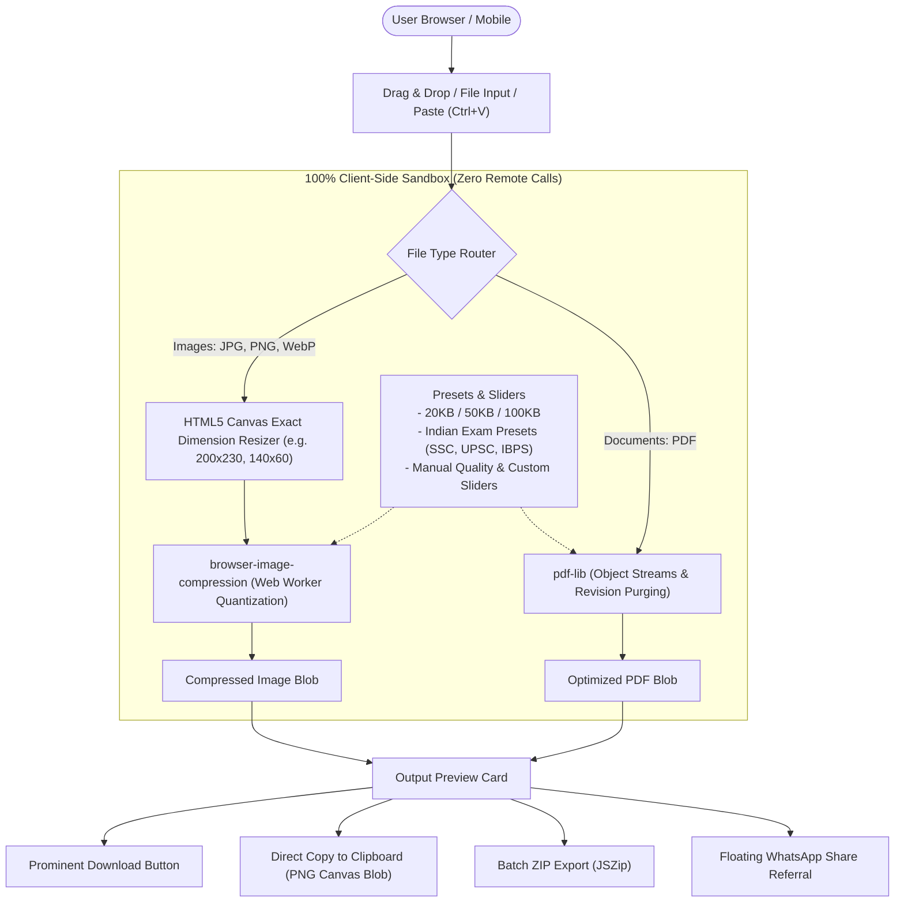

# ShrinkPure — Zero-Server Image & PDF Compression Engine & SEO Machine

A high-performance, production-ready web application built with **Next.js (App Router)** and **Tailwind CSS**. Designed for **100% pure client-side image and PDF compression**, organic Google search dominance, viral referral utility, and zero server storage.

> **100% Private & Secure — Files are processed on your device and never uploaded to any server.**

---

## High-Volume Programmatic SEO Landing Pages

All landing pages are statically pre-rendered (`generateStaticParams`) with custom H1 headers, tailored metadata, targeted FAQ schemas, and pre-selected presets:

| Route | Pre-Selected Preset / Dimensions | Target Search Intent |
| :--- | :--- | :--- |
| **[`/compress-image-to-20kb`](/compress-image-to-20kb)** | Under 20 KB Preset | Government exam portals, candidate signature uploads |
| **[`/compress-image-to-50kb`](/compress-image-to-50kb)** | Under 50 KB Preset | Passport photos, visa applications, state recruitment |
| **[`/compress-image-to-100kb`](/compress-image-to-100kb)** | Under 100 KB Preset | Certificates, academic marksheets, high-detail photos |
| **[`/compress-pdf-under-100kb`](/compress-pdf-under-100kb)** | Under 100 KB PDF Target | Tax slips, bank statements, confidential identity proofs |
| **[`/ssc-photo-resizer`](/ssc-photo-resizer)** | **200 × 230 px** & < 50 KB | SSC CGL, CHSL, MTS & GD official specs |
| **[`/signature-compressor-20kb`](/signature-compressor-20kb)** | **140 × 60 px** & < 20 KB | UPSC, SSC, IBPS, Railways, JEE & NEET signatures |

---

## Architecture & Data Flow



---

## Production SEO & Technical Architecture

### 1. Structured Data (JSON-LD)
Every route injects valid, rich schema markup using [`src/components/SeoStructuredData.tsx`](src/components/SeoStructuredData.tsx):
- **`WebApplication` Schema**: Highlights zero server upload privacy, offline WebAssembly/Canvas processing, free offer details, and browser requirements.
- **`FAQPage` Schema**: Grounded in official exam specifications and client-side privacy answers to capture Google rich snippet accordions in SERP.

### 2. Native Dynamic `sitemap.xml` & `robots.txt`
- [`src/app/sitemap.ts`](src/app/sitemap.ts): Dynamically enumerates root and all programmatic landing pages with update frequencies and priorities.
- [`src/app/robots.ts`](src/app/robots.ts): Full search engine crawl permissions pointing to canonical `sitemap.xml`.

### 3. Progressive Web App (PWA) & Offline Mode
- [`src/app/manifest.ts`](src/app/manifest.ts): Configures full PWA manifest with standalone display and brand palette.
- [`public/sw.js`](public/sw.js): Lightweight offline service worker caching application shell.
- [`src/components/PwaInstallPrompt.tsx`](src/components/PwaInstallPrompt.tsx): Native "Add to Home Screen" prompt with offline status indicator.

### 4. Viral Growth & Conversion Features
- **🇮🇳 Indian Exam Presets**: Instant dimension & byte locking for:
  - *Passport Photo*: 350x450 px, < 50 KB
  - *Signature*: 140x60 px, < 20 KB
  - *SSC Official Photo*: 200x230 px, < 50 KB
  - *Document / Certificate*: < 100 KB
  - *Left Thumb Impression*: 160x100 px, < 30 KB
- **Direct Copy to Clipboard**: Mobile and desktop users can copy compressed images straight to clipboard via the Clipboard API, avoiding download folder clutter.
- **Viral WhatsApp Share**: Floating referral button with pre-filled message:
  `"Resize signatures (<20KB) & photos (<50KB) for government exam forms with zero server uploads: [CURRENT_URL]"`

### 5. CLS-Protected Strategic Ad Slots
- `ad-slot-header`: Fixed min-height `50px` (mobile 320x50) / `90px` (desktop 728x90 leaderboard).
- `ad-slot-action`: Fixed min-height `250px`, width `300px` (300x250 medium rectangle).
- `ad-slot-footer`: Fixed min-height `90px` (responsive bottom leaderboard).

---

## Running Locally

```bash
# Start development server
npm run dev

# Run ESLint validation (0 errors, 0 warnings)
npm run lint

# Production compilation & static page generation
npm run build

# Start production server
npm run start
```

Visit [http://localhost:3000](http://localhost:3000) or any landing page e.g. [http://localhost:3000/ssc-photo-resizer](http://localhost:3000/ssc-photo-resizer).
